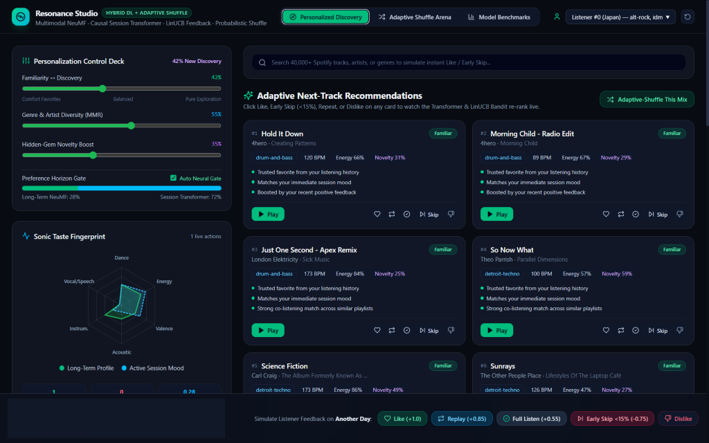
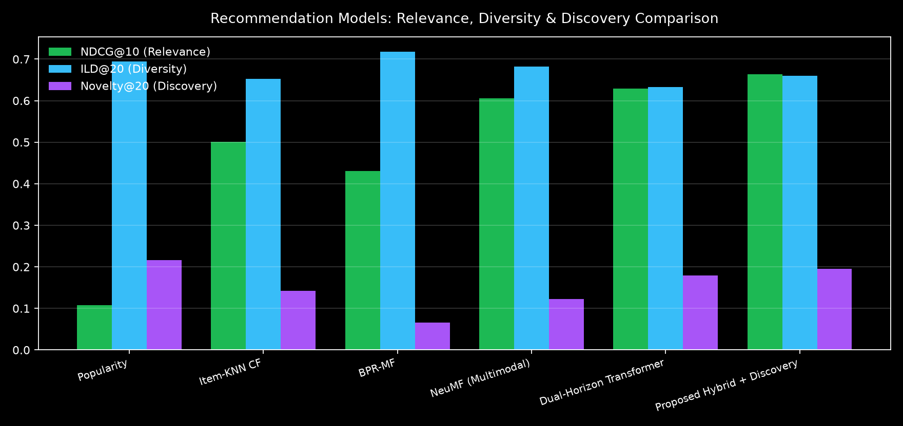
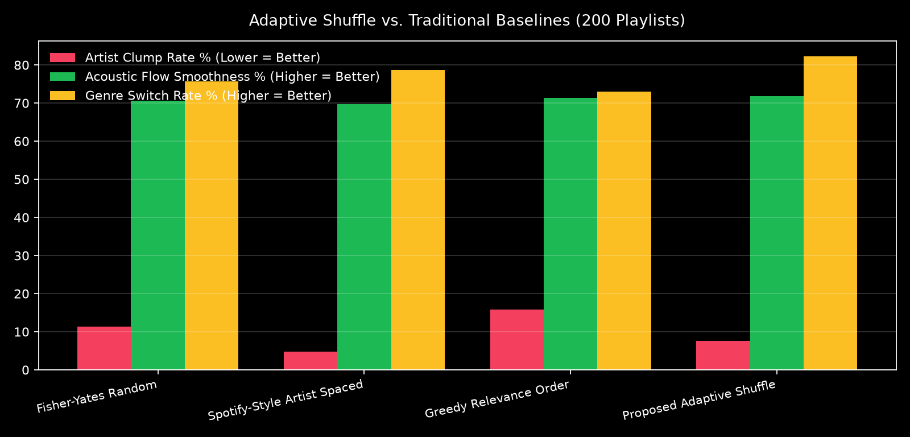

# Resonance — Intelligent Music Recommendation & Adaptive Shuffle System

An end-to-end Machine Learning, Deep Learning, and Probabilistic Optimization platform addressing playlist artist/genre clumping, acoustic whiplash, and static personalization in modern music streaming platforms.



---

## Core Architecture & Capabilities

1. **Shared Multimodal Representation Space ($\mathbb{R}^{128}$):** Fuses collaborative track IDs, 12D standardized Spotify acoustic features (`danceability`, `energy`, `valence`, `tempo`, `acousticness`, `instrumentalness`, `speechiness`, `liveness`, `loudness`, `key`, `mode`, `explicit`), genre embeddings, and artist embeddings with modality dropout (`p = 0.15`) for cold-start discovery alignment.
2. **Dual-Horizon Preference Modeling:** Combines **Neural Collaborative Filtering (`NeuMF`)** for stable long-term taste ($\mathbf{u}_{\text{long}}$) with a **2-Layer Causal Session Transformer** over chronological listening sequences and timestamp-derived implicit actions (`early_skip`, `partial_play`, `complete_play`, `repeat`, `like`) for active session mood ($\mathbf{u}_{\text{short}}$).
3. **Familiarity vs. Discovery Controller:** Dual-pool vector retrieval + Maximal Marginal Relevance (`MMR`) + Self-Information Novelty ($-\log_2 P(i)$).
4. **Continuous Online Feedback Loop:** Sub-millisecond diagonal **LinUCB Contextual Bandit** + dynamic artist/genre fatigue memory adapting live to skips, likes, listening duration, and repeats.
5. **Constrained Probabilistic Adaptive Shuffle:** Optimizes personalized relevance, Circle-of-Fifths / harmonic BPM / energy transition flow, sliding-window diversity, and exponential artist/genre cooldown penalties with Boltzmann temperature sampling.

---

## Empirical Benchmark Highlights

Trained and evaluated on a fused catalog of **40,000 Spotify tracks** (8,146 artists, 114 genres), **6,932 curated Spotify playlists**, **2,067,551 matched timestamped Last.fm listening events**, and **327,754 retained timestamp-derived listening interactions** across **943 multi-session listeners**:

### 1. Next-Track Recommendation (Chronological Leave-Last-Out Split)

| Model | `HR@10` ↑ | `NDCG@10` ↑ | `MRR@10` ↑ | `ILD@20` ↑ | `Novelty@20` ↑ | `Coverage@20` ↑ |
| :--- | :---: | :---: | :---: | :---: | :---: | :---: |
| Popularity Baseline | 20.83% | 0.1074 | 0.0764 | 0.6939 | 0.2161 | 0.07% |
| Item-KNN Co-occurrence CF | 67.17% | 0.5008 | 0.4468 | 0.6528 | 0.1426 | 9.74% |
| BPR Matrix Factorization | 70.00% | 0.4311 | 0.3477 | **0.7181** | 0.0659 | 3.24% |
| Multimodal NeuMF (`GMF + MLP`) | 76.00% | 0.6059 | 0.5568 | 0.6820 | 0.1226 | 11.08% |
| Dual-Horizon Session Transformer | 77.50% | 0.6289 | 0.5839 | 0.6330 | 0.1794 | 13.00% |
| **Proposed Hybrid + Discovery (MMR)** | **79.67%** | **0.6631** | **0.6214** | 0.6605 | **0.1958** | **13.19%** |



### 2. Adaptive Shuffle vs. Baselines (200 Curated Playlists)

| Shuffle Algorithm | Artist Clump Rate ↓ | Min Artist Gap ↑ | Genre Switch % ↑ | Acoustic Flow ↑ | Mean BPM Jump ↓ | Session `NDCG` ↑ |
| :--- | :---: | :---: | :---: | :---: | :---: | :---: |
| Fisher-Yates True Random | 11.40% | 2.01 | 75.74% | 70.62% | ±21.45 BPM | 0.3063 |
| Spotify-Style Artist Spaced | **4.79%** | **6.21** | 78.70% | 69.80% | ±22.00 BPM | 0.3068 |
| Greedy Relevance Order | 15.87% | 1.61 | 73.08% | 71.33% | ±21.02 BPM | **0.7400** |
| **Proposed Adaptive Shuffle** | **7.63%** | **3.53** | **82.24%** | **71.87%** | **±20.65 BPM** | **0.5250** |



### 3. Real-Time Online Feedback Adaptation (100 Simulated Mood Shifts)
- **Before Feedback:** Fatigued/Skipped Genre Share = `38.30%` · Newly Liked Genre Share = `0.95%`
- **After 3 Early Skips + 3 Likes (`LinUCB + Fatigue Memory`):** Fatigued Genre Share = **`0.05%`** · Newly Liked Genre Share = **`44.45%`**

---

## Quick Start

### 1. Set Up Python 3.12 Virtual Environment
```powershell
uv venv backend/.venv --python 3.12
uv pip install --python backend/.venv/Scripts/python.exe torch --index-url https://download.pytorch.org/whl/cu124
uv pip install --python backend/.venv/Scripts/python.exe duckdb fastapi "uvicorn[standard]" pydantic pyarrow pandas numpy scipy huggingface-hub tqdm matplotlib pytest httpx
```

### 2. Download & Build Unified Dataset
```powershell
$env:PYTHONPATH = "."
backend\.venv\Scripts\python.exe -m backend.data_pipeline.download_and_build --mpd-slices 10 --max-catalog 40000
```

### 3. Train Models on GPU & Run Benchmark Suites
```powershell
$env:PYTHONPATH = "."
backend\.venv\Scripts\python.exe -m backend.training.train_and_evaluate
```

### 4. Launch Backend API & Next.js Studio UI
```powershell
# Or simply run .\start_dev.ps1
# Terminal 1 — FastAPI Engine (http://127.0.0.1:8000)
$env:PYTHONPATH = "."
backend\.venv\Scripts\uvicorn.exe backend.app.main:app --host 127.0.0.1 --port 8000

# Terminal 2 — Next.js Studio (http://localhost:3000)
cd frontend
npm.cmd install
npm.cmd run dev
```
