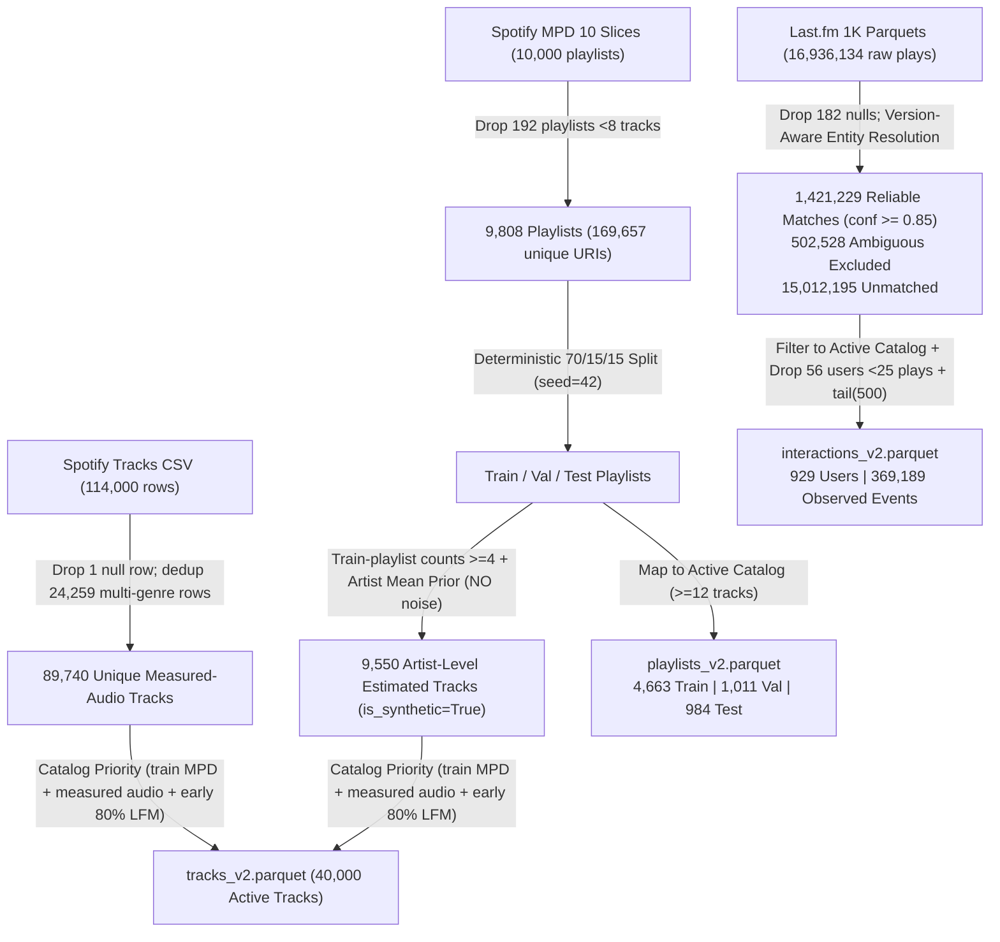

# Data Lineage (`docs/DATA_LINEAGE.md`)

**Pipeline Version:** `v2` ([backend/data_pipeline/build_verified_dataset.py](file:///c:/Users/Mayoura/Desktop/SPOTIFY-THING/backend/data_pipeline/build_verified_dataset.py))  
**Output Directory:** `data/processed_v2/` (legacy `data/processed/` preserved untouched)  
**Verified Build Date:** 2026-11-27 (`build_seconds: 128.34s`, pure PyArrow/Pandas)

---

## End-to-End Lineage Diagram

---

## Stage-by-Stage Record Accounting

| Stage | Input Records | Output Records | Dropped / Excluded | Transformation Rule |
| :--- | ---: | ---: | ---: | :--- |
| **1. Spotify Audio CSV** | 114,000 | 89,740 | 1 null; 24,259 multi-genre duplicates | Deduplicate by `spotify_track_id` while aggregating `all_genres`. |
| **2. Spotify MPD (10 slices)** | 10,000 playlists | 9,808 playlists | 192 playlists (`<8` tracks) | Split deterministically 70/15/15 (`seed=42`) before computing `train_mpd_count`. |
| **3. Entity Resolution (Last.fm → Catalog)** | 16,936,134 | 1,421,229 | 182 nulls; **502,528 ambiguous**; 15,012,195 unmatched | Retain only `exact_normalized` (`1,251,638`) and `packaging_stripped_high` (`169,591`) with `match_confidence >= 0.85`. |
| **4. Active Catalog (`tracks_v2.parquet`)** | ~100k candidates | **40,000** | Tail outside top-40k | 120 tracks/genre floor + priority from train MPD, measured audio, and first-80% chronological Last.fm plays (`30,450` measured + `9,550` artist-estimated). |
| **5. Observed Sessions (`interactions_v2.parquet`)** | 1,421,229 | **369,189** | 56 low-activity users (`<25` plays); 1,047,276 older events beyond `tail(500)` | Strictly chronological per user; observed-only `track_listened_event` (`82,251`) and causal `repeated_track_event` (`286,938`). |
| **6. Filtered Playlists (`playlists_v2.parquet`)** | 9,808 playlists | **6,658** | 3,150 playlists (`<12` active tracks) | Preserves disjoint `train` (`4,663`), `val` (`1,011`), and `test` (`984`) splits. |
