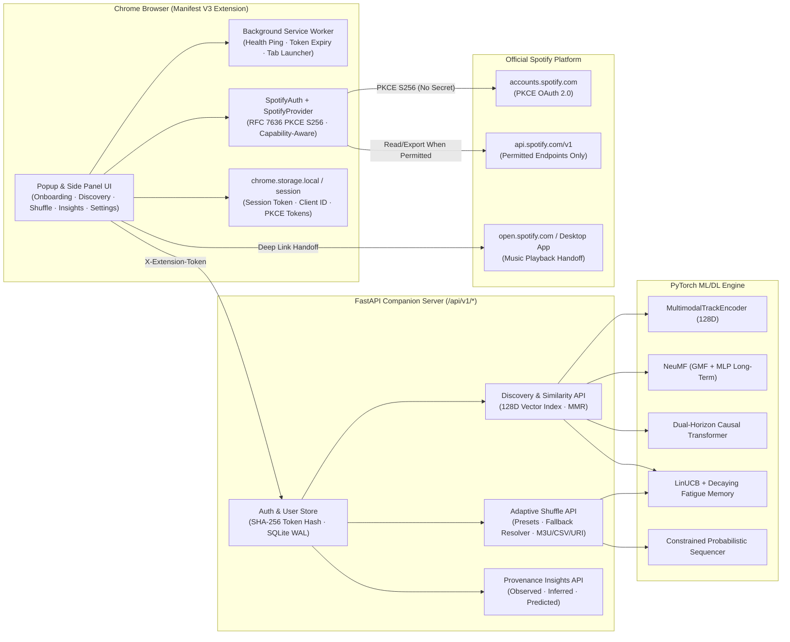

# SPOTIFY-THING — Chrome Companion Extension Architecture

## 1. Architectural Vision

**SPOTIFY-THING** operates as an independent AI-powered Chrome Companion Extension alongside Spotify:

- **Spotify** remains the user's music streaming and playback platform.
- **SPOTIFY-THING** provides an independent neural recommendation, Adaptive Shuffle sequencing, preference analysis, and online bandit personalization layer.

---

## 2. Extension Structure (`extension/`)

- [manifest.json](file:///c:/Users/Mayoura/Desktop/SPOTIFY-THING/extension/manifest.json): Manifest V3 configuration with minimal permissions (`storage`, `identity`, `sidePanel`), strict CSP (`script-src 'self'; object-src 'self'`), and **zero** content scripts injected into `open.spotify.com`.
- [service-worker.ts](file:///c:/Users/Mayoura/Desktop/SPOTIFY-THING/extension/src/background/service-worker.ts): Event-driven MV3 background worker handling health checks, token validity checks, and expanded companion tab launching.
- [api.ts](file:///c:/Users/Mayoura/Desktop/SPOTIFY-THING/extension/src/services/api.ts): Typed `/api/v1/*` client with automatic session provisioning and error token redaction.
- [spotify-auth.ts](file:///c:/Users/Mayoura/Desktop/SPOTIFY-THING/extension/src/services/spotify-auth.ts) & [spotify-api.ts](file:///c:/Users/Mayoura/Desktop/SPOTIFY-THING/extension/src/services/spotify-api.ts): Official OAuth 2.0 Authorization Code + PKCE (`S256`) and capability-aware `SpotifyProvider` adapter.
- Pages:
  - [OnboardingFlow.tsx](file:///c:/Users/Mayoura/Desktop/SPOTIFY-THING/extension/src/components/OnboardingFlow.tsx): First-run introduction, Independent vs. PKCE mode choice, and initial taste calibration.
  - [Discovery.tsx](file:///c:/Users/Mayoura/Desktop/SPOTIFY-THING/extension/src/pages/Discovery.tsx): Familiarity vs. Discovery controller, neural explanations, rich feedback actions, and 128D Similar Tracks / Similar Artists exploration.
  - [AdaptiveShuffle.tsx](file:///c:/Users/Mayoura/Desktop/SPOTIFY-THING/extension/src/pages/AdaptiveShuffle.tsx): 5-axis preset controls, Original vs. Generated sequence comparison, baseline metrics, and multi-format export/handoff.
  - [Insights.tsx](file:///c:/Users/Mayoura/Desktop/SPOTIFY-THING/extension/src/pages/Insights.tsx): Provenance-separated analytics (`Observed`, `Inferred Preference`, `Model Prediction`) with temporary artist/genre fatigue controls.
  - [Settings.tsx](file:///c:/Users/Mayoura/Desktop/SPOTIFY-THING/extension/src/pages/Settings.tsx): PKCE configuration, backend health check, bandit reset, and complete user data deletion.

---

## 3. Data & Model Independence

1. **Independent Model Training Data:** `MultimodalTrackEncoder`, `NeuMF`, `DualHorizonSessionTransformer`, and `ItemCooccurrenceCF` are trained strictly on offline research datasets — never on data fetched from the Spotify Web API.
2. **Isolated User State:** Every extension user receives a SHA-256-hashed session token in [extension_store.py](file:///c:/Users/Mayoura/Desktop/SPOTIFY-THING/backend/app/engine/extension_store.py) and an isolated `feedback_slot_idx >= 1,000,000` in [feedback_store.py](file:///c:/Users/Mayoura/Desktop/SPOTIFY-THING/backend/app/engine/feedback_store.py).
3. **Graceful Metadata Fallback:** When sequencing tracks missing from the 40,000-track catalog, [recommender.py](file:///c:/Users/Mayoura/Desktop/SPOTIFY-THING/backend/app/engine/recommender.py) applies artist prototype priors or deterministic artist-hash spacing without calling restricted Spotify audio-feature endpoints.
